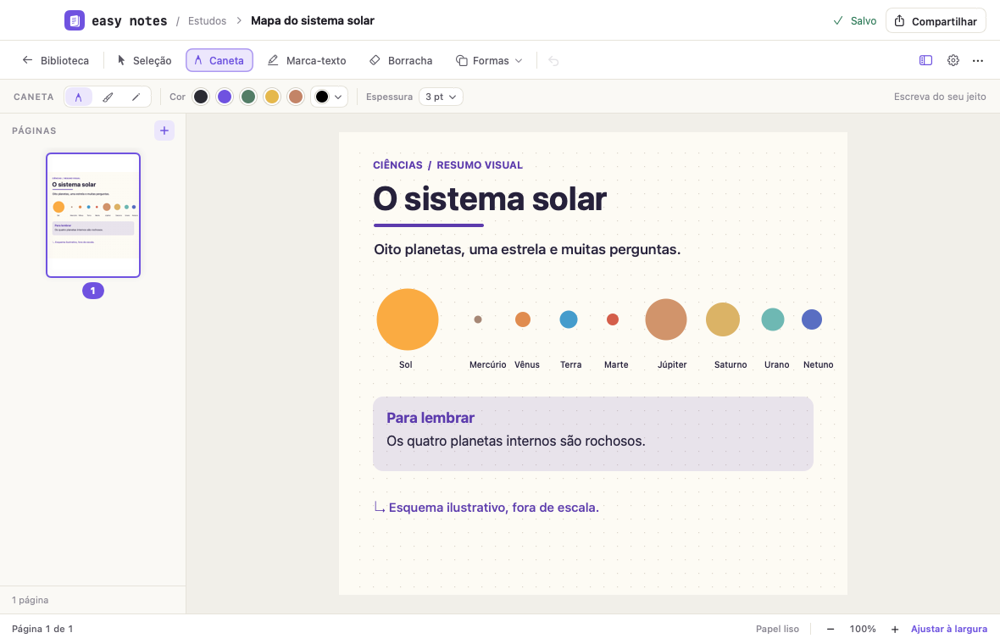
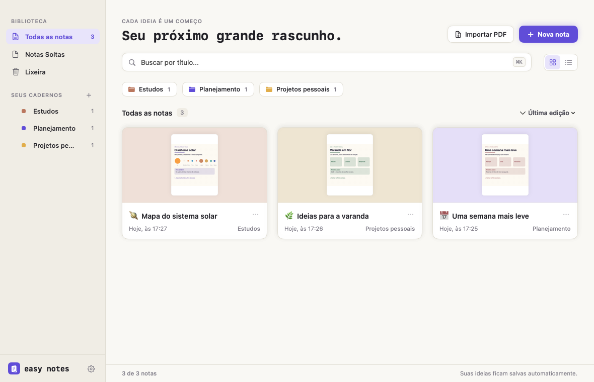

  

<h1 align="center">Easy Notes</h1>

Um aplicativo nativo e totalmente gratuito para macOS, com código-fonte público. Organize suas anotações, escreva à mão e marque PDFs no mesmo lugar.

  <strong><a href="https://github.com/Fefevs09/easy-notes-ios/releases/download/v1.0-build.1-preview.1/Easy-Notes-1.0-1-macOS-universal-local.dmg">Baixar a prévia (.dmg)</a></strong>
  ·
  <a href="https://github.com/Fefevs09/easy-notes-ios/releases/tag/v1.0-build.1-preview.1">Notas da versão e checksum SHA-256</a>

Prévia 1.0 (build 1) · macOS 26.2 ou posterior · Universal (Apple silicon e Intel)

## Por dentro do Easy Notes

*Exemplo de estudo com esquema visual e resumo em destaque. A imagem combina a interface do editor com a renderização do PDF de demonstração.*

*Na biblioteca, os cadernos agrupam suas notas e a visualização em grade ajuda a encontrar a página certa.*

## O que você pode fazer

- **Encontre suas notas rapidamente.** Separe estudos, projetos e ideias em cadernos. Use a busca e alterne entre grade e lista.
- **Escreva e desenhe do seu jeito.** Combine lápis, canetas, marca-texto e formas. Escolha papel pautado, quadriculado ou pontilhado para cada nota.
- **Trabalhe com PDFs.** Importe documentos, faça marcações diretamente nas páginas e exporte o resultado em PDF.
- **Guarde suas notas no Mac.** O app salva a biblioteca localmente e funciona sem exigir conta.

## Instalação

Abra o arquivo `.dmg` e arraste o **Easy Notes** para a pasta **Aplicativos**.

A prévia tem assinatura ad hoc e foi distribuída sem notarização da Apple. O Gatekeeper pode bloquear a abertura.

## Desenvolvimento

Abra `Easy Notes.xcodeproj` no Xcode, selecione o esquema **Easy Notes** e o destino **My Mac**, e pressione **⌘R**. O projeto foi testado com o Xcode 27.2.
